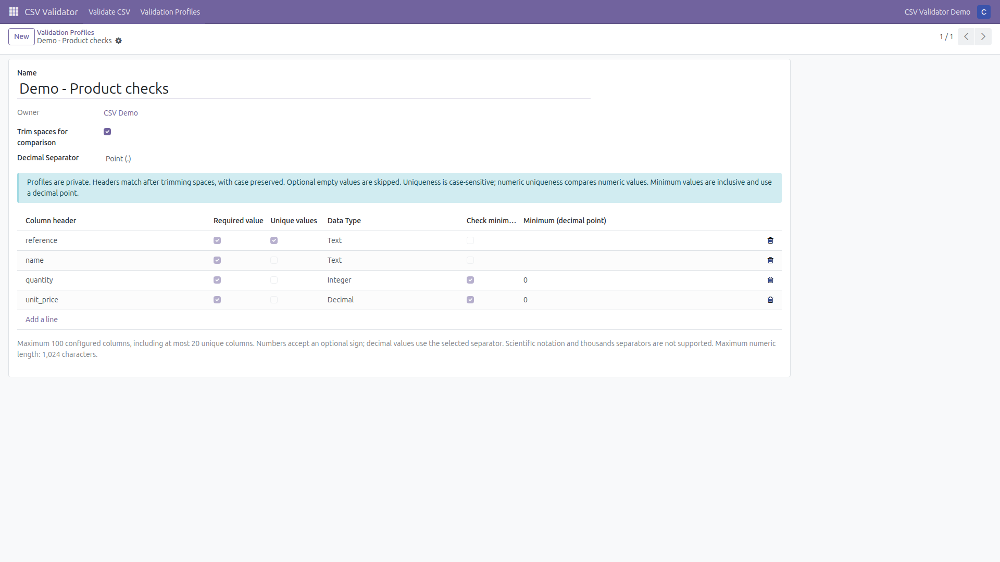
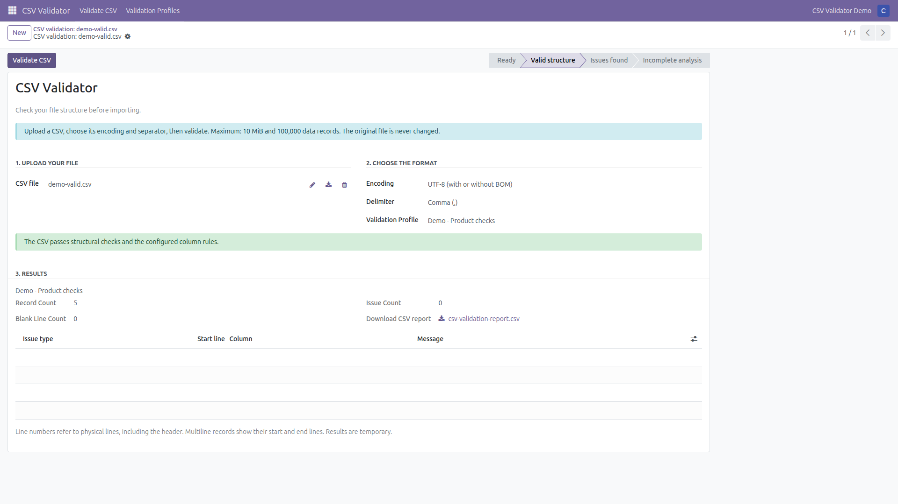
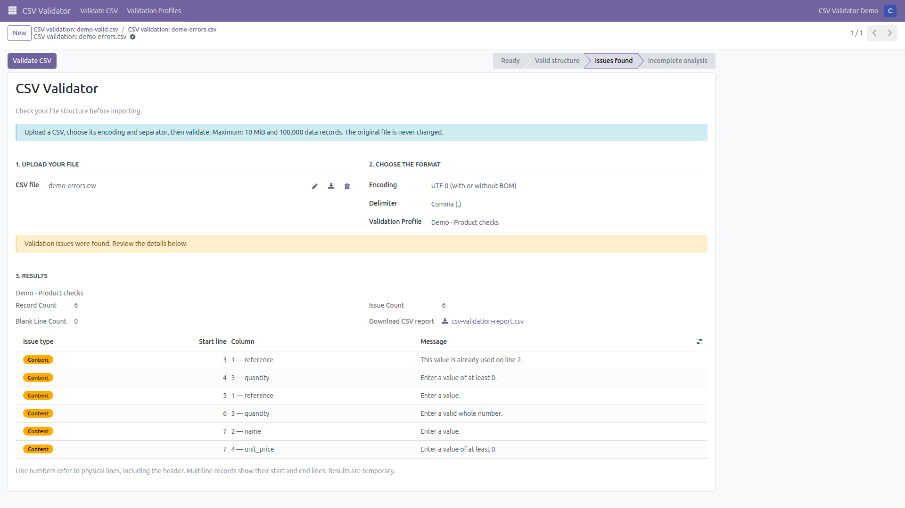

# Odoo CSV Validator 2.0

Version **18.0.2.2.0** for **Odoo 18 Community**. Validate CSV structure and optional private column rules before importing. Download an issue report without changing or importing the source data.

Licensed under **GNU LGPL version 3 (LGPL-3.0-only)**. See [LICENSE](LICENSE) and the incorporated GPL terms in [COPYING](COPYING). Both texts are also included inside the addon for standalone distribution.

## Demo

[](https://youtu.be/mF-xWQ5Pu58)

The video opens with a previously configured validation profile. A CSV file is then uploaded and validated against that profile's rules, showing the detected errors and validation results. The original file is neither modified nor imported into Odoo.

The screenshots below use synthetic demonstration data in Odoo 18 Community.

**Validation profile and column rules**



**Successful validation: five records, no issues**



**Error report: six records, six issues**



[Download the generated demo error report](docs/media/demo-errors-report.csv).

## Features

- Explicit UTF-8 (with or without BOM) or Windows-1252, and comma, semicolon or tab separator.
- Empty files/headers, duplicate headers, record widths, CSV parser errors and NUL detection. Issues identify physical lines, including multiline records; encoding/NUL errors include source byte offsets.
- Optional column rules: required, unique, text, integer, decimal and an inclusive numeric minimum. Decimal thresholds use exact arithmetic.
- Private profiles and uploads, restricted to internal users. Results are server-managed; ordinary RPC calls cannot forge state, counters, snapshots, reports or issues.
- English interface and Catalan translation. Native Odoo forms and downloadable UTF-8 BOM reports with ten stable columns, totals and completion/truncation indicators.

## Requirements

- An Odoo 18 Community installation with its normal Python and PostgreSQL dependencies. The addon depends only on `base`; it needs no additional Python packages or Enterprise modules.
- For the local recipe: Docker Engine, Docker Compose v2, permission to use Docker, network access to obtain `odoo:18.0` and `postgres:15`, and an available loopback port (8070 by default).
- Standalone engine/catalog tests use Python 3.10 or later and its standard library. Integration tests require Odoo and PostgreSQL; local HTTP tests require the web service to be running.

## Install in an existing Odoo 18 instance

1. Copy `addons/odoo_csv_validator/` into a directory already on your Odoo `addons_path`, or add its parent directory while retaining your existing addon paths.
2. Restart Odoo, enable developer mode, update the Apps list and install **Odoo CSV Validator**. Remove the default Apps filter if necessary to find it.
3. Open **CSV Validator > Validate CSV**. Upload a CSV, select encoding and separator, optionally select a profile, and click **Validate CSV**. Use **Download CSV report** to download the result.

Use your normal Odoo module-upgrade procedure when updating an existing installation. Docker is development infrastructure, not an addon dependency.

## Local Docker installation

From the repository root:

```sh
cp .env.example .env
# Edit .env and replace CSV_DB_PASSWORD with a local random password.
docker compose up -d db
docker compose run --rm odoo odoo -d csv_validator -i odoo_csv_validator --stop-after-init --no-http --without-demo=all
docker compose up -d odoo
```

Open <http://localhost:8070> (or the port selected by `CSV_ODOO_PORT`). A newly initialized database uses the initial login `admin` and password `admin`; change it immediately. Existing database credentials are not reset by these instructions.

Compose uses project `odoo-csv-validator-v2`, its own network and named volumes. PostgreSQL has no host port; Odoo binds only to `127.0.0.1`. The web service selects only `csv_validator` through both `db_name` and an exact `dbfilter`. `list_db = False` disables the database manager. Other local projects must use different Compose project names and ports.

This configuration is for local development. It does not configure public hosting, TLS or a reverse proxy. Image tags select major releases and can change; use image digests if you require reproducible infrastructure. Database and Odoo volumes persist across container restarts.

## Validation profiles and permissions

Administrators can grant internal users **CSV Validator: Manage own validation profiles** through Odoo's user access-rights form. The initial administrator receives this group on installation/upgrade. Other internal users can perform structural validation without profiles. Authorized users can manage only their own profiles and rules under ordinary access; explicit superuser mode retains maintenance access.

Create a profile under **CSV Validator > Validation Profiles**. Add one rule per CSV header and combine requiredness, uniqueness, type and minimum. Select the profile when validating, or leave it empty for structural-only checks. No user-supplied code or expressions are executed.

Header matching trims outer whitespace and is case-sensitive. Value comparison trims whitespace by default; disabling trimming makes spaces significant. Optional empty cells skip numeric, minimum and uniqueness checks. Text uniqueness preserves case and leading zeroes; numeric uniqueness compares values (`1`, `1.0` and `+01.00` coincide for decimals). Missing or ambiguous configured columns make analysis incomplete. Wrong-width records receive structural errors rather than content checks.

Results snapshot the applied profile and headers. Editing a profile affects the next run; deleting one preserves earlier reports and snapshots. Changing the upload, encoding, delimiter or selected profile clears the result. Revalidation replaces the previous result atomically. Unexpected persistence failures produce a generic error after restoring the result savepoint; Odoo concurrency retries are preserved.

## Limits and supported behavior

| Limit | Value |
| --- | --- |
| Decoded upload | 10 MiB |
| Columns per logical record | 1,000 |
| Header size | 64 KiB in the selected encoding |
| Data records analyzed | 100,000 |
| Detailed issues retained/exported | 1,000 |
| Configured rules per profile | 100 |
| Columns with uniqueness checks | 20 |
| Stored unique keys per run, across columns | 100,000 |
| Estimated unique-key storage | 32 MiB |
| Numeric input length | 1,024 characters |
| Decoded report persisted by Odoo | 10 MiB |
| Serialized JSON per result snapshot | 512 KiB |

Header size includes CSV syntax and embedded newlines, excluding the BOM and terminating newline. A guard checks column/header limits before giving the offending physical line to the parser, respecting quoted delimiters, escaped quotes and multiline fields. Python's process-wide CSV field-size limit also applies; the addon does not change it. These budgets do not represent a global process-memory or concurrent-upload limit. Further result-field storage limits are documented in the [validation specification](docs/validation-spec.md).

Empty files are errors; a header-only CSV can pass with zero data records. Empty physical records after the header are skipped and counted separately. All detected issues are counted even after the detail limit, until analysis stops. Decode errors, NUL, parser errors and resource limits make analysis incomplete. NUL is detected before decoding/parsing and reports the first source byte offset and physical line; the original upload remains in its binary field, without copying NUL into text or JSON results.

The accepted dialect is Python `csv.reader(..., strict=True)`, not a universal CSV conformance checker: for example, a quote inside an unquoted field may be accepted. Encoding/separator selection is explicit; no automatic detection, UTF-16, scientific notation, thousands separators, NaN or infinity is supported. Integer/decimal syntax and all profile semantics are described in the [column-rules specification](docs/column-rules-spec.md).

The addon does not validate against Odoo business models, check importability, correct cells, import records or apply product-specific rules. Passing validation means that the selected structural checks and configured rules passed.

Uploads and results are transient. The one-hour age is a cleanup threshold, not a guaranteed deletion deadline; Odoo cleanup and backups can retain data longer. Profiles remain until deleted. Reports contain header names, profile restrictions and diagnostics. Live UI text follows the current language; stored downloads retain the language used during validation. Spreadsheet-formula prefixes in exported text are neutralized.

## Tests

From the repository root, run the engine and rules without Odoo, and check the catalogs:

```sh
python3 -B -m unittest discover -s addons/odoo_csv_validator/tests -p test_csv_validator.py -v
python3 -B -m unittest discover -s addons/odoo_csv_validator/tests -p test_column_rules.py -v
python3 -B -m unittest discover -s tests -p test_translation_catalog.py -v
```

For a clean installation and the Odoo integration/JSON-RPC suite, use a new dedicated test database (Bash):

```sh
CSV_TEST_DB="csv_validator_test_$(date +%Y%m%d%H%M%S)"
docker compose --profile test run --rm test odoo -d "$CSV_TEST_DB" "--db-filter=^${CSV_TEST_DB}$" -i odoo_csv_validator --test-enable --test-tags /odoo_csv_validator --stop-after-init --no-http --without-demo=all
```

This creates a test database and leaves it in the local PostgreSQL volume. It does not use the application database. The test container's filestore is temporary; use a fresh test database for independent runs. The shorter `docker compose --profile test run --rm test` command uses the fixed database `csv_validator_test`; it does not guarantee a clean installation on repeat runs.

With the local web service running, run the three external HTTP checks:

```sh
python3 -B -m unittest discover -s tests -p test_local_environment.py -v
```

Set `CSV_HTTP_URL` to use another local URL/port. The current suite contains **126 test methods**: 54 standalone engine/rule tests, 65 Odoo integration/RPC tests, four catalog tests and three external HTTP tests. The Odoo runner reports the integration tests separately; the standalone unittest classes must also be run using the commands above.

## Repository contents and distribution

`addons/odoo_csv_validator/` is the installable addon. `compose.yaml` and `docker/` provide the local environment; `tests/` contains external checks. The three root `productes*.csv` files are synthetic product fixtures, with intentional invalid values/duplicates; they are not customer exports or a promise of product-specific validation.

The [validation specification](docs/validation-spec.md), [column-rules specification](docs/column-rules-spec.md) and [presentation specification](docs/usability-spec.md) describe current behavior. The [original proposal](docs/configurable-column-rules-proposal.md) is a historical design record, not an installation guide or a list of unimplemented current features.

`.env` and its local variants, virtual environments, caches, logs, private keys, backups and local upload/report directories are ignored. Only the placeholder `.env.example` is intended for publication. Keep real user files in the ignored `uploads/` directory and generated reports in `reports/`; a `.gitignore` cannot sanitize files already committed or recognize secrets in arbitrary source files.

For GitHub, publish the repository sources and documentation. For a standalone addon archive, package only `addons/odoo_csv_validator/`, including its `LICENSE` and `COPYING`. An Odoo Apps listing is a separate publication step requiring its own metadata and presentation review.
